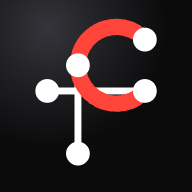

<p align="center"></p>

# Flex & Count — Bicep Curl Rep Counter

Counts bicep curl reps in real time with pose estimation. v2 runs in the browser: open the link, allow the camera, and start curling. No install, no Jupyter.

<p>
  <a href="https://github.com/naarrzz/pose-estimation-bicep-curl-counter/releases/latest/download/FlexAndCount.apk"></a>
  <a href="https://naarrzz.github.io/pose-estimation-bicep-curl-counter/"></a>
</p>

**Try it:** https://naarrzz.github.io/pose-estimation-bicep-curl-counter/ · on iPhone, Share → Add to Home Screen for a full-screen app.

## It started as a school project

Flex & Count began as our finals project: a Python app (Jupyter Notebook + Tkinter, MediaPipe + OpenCV) that counted right-arm bicep curls from a laptop webcam. That first version is still here, untouched: the [notebook](Flex%20and%20Count%E2%80%94Pose%20Estimation%20for%20Tracking%20Bicep%20Curl%20Reps.ipynb), [requirements.txt](requirements.txt), the [paper](Alcaide%20Pizarra%20Finals%20Project%20Paper.pdf), the [presentation](Presentation%20Flex%20and%20Count%20%E2%80%94%20Pose%20Estimation%20for%20Tracking%20Bicep%20Curl%20Reps.pdf), and its [original README](README-v1.md). Tag [`v1.0.0`](https://github.com/naarrzz/pose-estimation-bicep-curl-counter/tree/v1.0.0) is the repo exactly as it was.

v2 takes the same idea out of the notebook and into your pocket: a phone-first web app and an Android app that count both arms, standing or preacher, from the camera or a recorded video.

## What's new in v2

| | v1 (finals project) | v2 (web app) |
|---|---|---|
| Runs on | Laptop with Python + Jupyter | Any phone or laptop browser |
| Curls | Standing, right arm | Standing or preacher, right, left or both arms (alternating works too) |
| Form check | — | Standing: flags reps where the elbow swings forward (still counted, not "strict"). Preacher: no swing check |
| Input | Webcam (hardcoded camera index) | Front/back camera, or a recorded video with trim |
| Feedback | Pop-up when the goal is hit | Rep sound and vibration, live elbow angle, set history |
| Look | Tkinter window | Light and dark mode |
| Privacy | Local | Still local: the model runs on your device, video is never uploaded |
| Tests | — | Unit tests for the angle and rep logic |

## How it works

1. **Pose estimation:** [MediaPipe Pose Landmarker](https://ai.google.dev/edge/mediapipe/solutions/vision/pose_landmarker) (lite model) finds 33 body landmarks per frame, in the browser via WebAssembly (GPU when available).
2. **Elbow angle:** the angle at the elbow between the shoulder and wrist — same math as v1.
3. **Rep logic:** arm extended (past 160°, or 150° for preacher) = "down". Curled under 50° (55° preacher) after a "down" = one rep. Half reps that never reach the stretch don't count. The angle is smoothed so jitter doesn't double-count.
4. **Swing check (standing):** the hip–shoulder–elbow angle tracks how far the upper arm moves. Over 45° during a rep = flagged.
5. **Both arms:** each arm has its own counter and stops at the goal, so alternating curls work.

## Android app

1. On your Android phone, tap **Download Flex & Count.apk** above.
2. Open the downloaded file. The first time, Android asks to allow installs from your browser or Files app; allow it once.
3. Open **Flex & Count** and allow the camera.

The app is a thin shell (Kotlin WebView) around the web app, so new features arrive without a new download. It runs full screen and keeps the screen awake during sets. Source: [`android/`](android/). Build with JDK 17:

```bash
cd android && ./gradlew assembleDebug
```

## Run it locally

No build step. Serve the docs folder with any static server:

```bash
python3 -m http.server 5178 --directory docs
```

Then open http://localhost:5178 (the camera works on localhost or HTTPS only).

Run the tests (Node 20+):

```bash
npm test
```

## Files

```
docs/        v2 web app (index.html, style.css, app.js, counter.js, icons/) — served by GitHub Pages
android/     Android app (WebView shell), released as FlexAndCount.apk
design/      logo SVGs
test/        unit tests for docs/counter.js
*.ipynb, *.pdf, requirements.txt, README-v1.md   the original v1
```

## Credits

- v2 web app: Narz Angelo Alcaide
- v1: Narz Angelo Alcaide and Sebastian Lee C. Pizarra, finals project, De La Salle University–Dasmariñas
